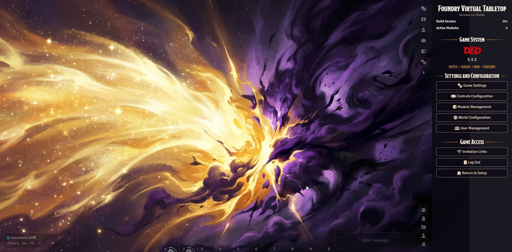
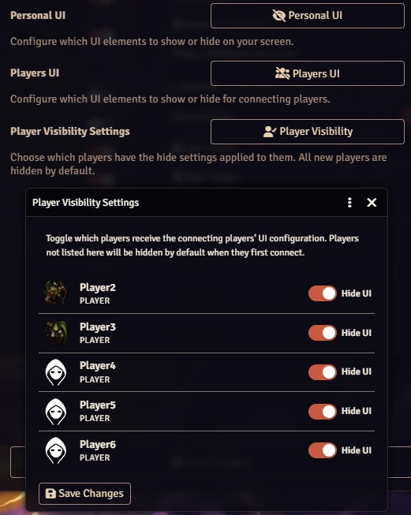
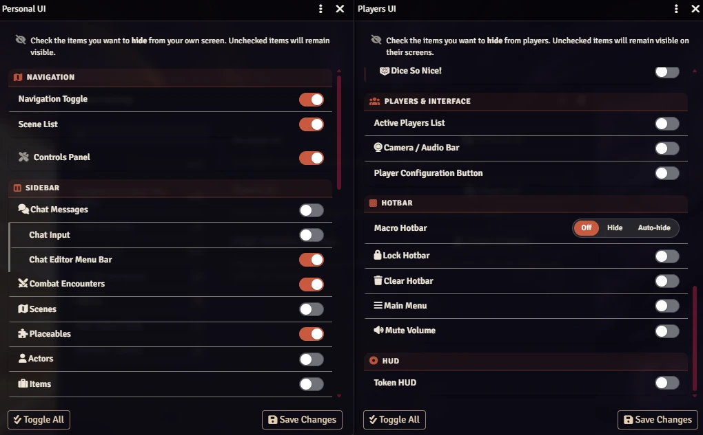

# Hide UI

Foundry shows every player the same toolbars, tabs and buttons the GM uses. Most of them a player never clicks.

Hide UI lets the GM choose which parts of the interface each player sees: the sidebar tabs, the scene navigation, the hotbar, the Token HUD buttons, and more. The GM can also tidy up their own screen, and any player can hide the camera dock for themselves. Everything else is decided by the GM.



[](https://buymeacoffee.com/mestredigital) [](https://mestredigital.online/pages/projetos-en)

## What it does

- You set one configuration for all connecting players, then choose which players it applies to. A player you exempt sees the full interface.
- A player who joins for the first time gets your configuration automatically.
- The GM has a separate Personal UI configuration for their own screen.
- When you save the players' configuration, every connected player gets a prompt to reload and apply it.
- One switch hides a whole section, such as the entire sidebar, or you can pick individual tabs and buttons.
- The Macro Hotbar can be hidden or set to auto-hide: after a few seconds it slides out of the way, and it comes back when the mouse moves over it.
- Info and warning notifications in the corner can be hidden. Error notifications have a separate option, off by default, so players still see real errors.
- Any user can hide the camera and audio dock on their own screen, whatever the GM has configured.

## What can be hidden

| UI Area | Elements You Can Toggle |
|---|---|
| Navigation | Full navigation bar · Nav toggle button · Scene list · Scene levels · Boss Bar |
| Controls | Left-side controls panel (the toolbelt) |
| Sidebar | Entire sidebar · Chat messages · Chat input box · Chat editor menu bar · Combat encounters · Scenes · Placeables · Actors · Items · Journal · Rollable tables · Card stacks · Macros · Playlists · Compendium packs · Settings tab · Dice So Nice tab |
| Settings tab contents | Game Settings · Active Modules · Tour Management · Help & Documentation |
| Players & Interface | Active players list · Camera / Audio bar · Player configuration button |
| Hotbar | Standard macro hotbar, with an optional auto-hide mode (Off / Hide / Auto-hide) that lets it peek at the bottom edge and reveal on hover · Individual hotbar controls: Lock Hotbar · Clear Hotbar · Main Menu · Mute Volume |
| HUD | Token HUD · Individual Token HUD buttons: Assign Status Effects · Movement Action · Target · Enter Combat · Open Configuration (Personal UI also offers Hide and Lock, GM-only buttons) · Token Action HUD |
| Notifications | Info & warning toasts (the corner pop-ups) · Error toasts, a separate option that is off by default so players keep seeing real errors |

You don't have to hide everything. Removing only the combat tracker or the compendium tab already helps players who find the interface busy.

## How to use it

1. Open **Game Settings**, then **Configure Settings**, and find **Hide UI**.
2. There are three configuration menus:

   | Menu | Purpose |
   |---|---|
   | **Personal UI** | Configure which UI elements are hidden on the GM's own screen |
   | **Players UI** | Set the default visibility for every connecting player |
   | **Player Visibility** | Choose which players the defaults apply to |

3. Open **Players UI**, turn on the elements you want to hide, and click **Save**.
4. Open **Player Visibility** to see a list of all your players. Turn each one on or off to choose who gets the hidden UI.
5. If you want, open **Personal UI** to configure your own screen separately from the players. Personal UI changes apply after a page reload.





## Hiding the cameras on your own screen

Any user, player or GM, can turn on **Hide All Cameras** in **Configure Settings**, under **Hide UI**. It is off by default and only affects your own screen. When it is on, the whole camera and audio dock disappears, wherever it is docked, and the game area takes the space it used. The page reloads to apply it.

The dock also holds your mute and camera buttons, so they disappear with it. To control your microphone, choose push-to-talk in **Configure Audio/Video**, or disable your camera and microphone there.

## Optional module support

Hide UI detects the following modules and adds their UI elements to the list when they are active:

| Module | Extra Toggle Added |
|---|---|
| [Token Action HUD](https://foundryvtt.com/packages/token-action-hud-core) | Token Action HUD panel |
| [Dice So Nice!](https://foundryvtt.com/packages/dice-so-nice) | Dice So Nice sidebar tab |
| [Boss Bar](https://foundryvtt.com/packages/bossbar) | Boss Bar |

There is nothing to configure. If the module is installed and active, the option appears.

## Emergency reset

If you hide the Settings tab by mistake, or can no longer reach the module settings from the interface, you can reset everything from the browser console.

1. Press **F12** to open the browser developer tools.
2. Go to the **Console** tab.
3. Type the following command and press **Enter**:

```js
HideUI.Reset();
```

This will:
- Set **Players UI** to hide all elements for all players, a known state you can then reconfigure.
- Turn the **Player Visibility** toggle back on for every player, so all players are affected on their next login.
- Clear every saved **Personal UI** configuration.
- Reload every connected client immediately.

Only the GM can run this command. After the reset, open **Players UI** and configure the visibility settings again.

## Installation

1. Open Foundry VTT and go to **Add-on Modules**.
2. Click **Install Module**.
3. Paste the following manifest URL in the **Manifest URL** field at the bottom:

```
https://raw.githubusercontent.com/brunocalado/hide-ui/main/module.json
```

4. Click **Install** and then enable the module in your world.

Hide UI requires Foundry VTT version 14.

## Bug reports and feature requests

Found a bug or have an idea for a new feature? Open an issue on GitHub: https://github.com/brunocalado/hide-ui/issues

## Credits and License

This module is released under the [GNU General Public License v3](LICENSE).

The new hide-ui module has undergone a profound redesign compared to the original hide-player-ui code, totaling 931 modified lines of code (470 insertions and 461 deletions) across 32 impacted files. The project was completely restructured for Foundry VTT v14: the original module's interface scripts, CSS styles, and old .html templates were entirely discarded. In their place, a robust architecture based on Handlebars templates (.hbs) was built, introducing new logic files such as user-configuration-form.js, hide-ui.js, helpers.js, and constants.js. The result is a brand-new, clean, and significantly expanded module developed from the original codebase.

This module is a fork of [hide-player-ui](https://github.com/gsimon2/hide-player-ui) by gsimon2. Thank you for the original work that made this possible.
